<div align="center">


# Score Reader

**Your whole music library on an Android tablet.<br/>Instant page turns. Works offline. No account. Buy once.**

<sub>Working name · Android 10+ · tablets first, phones too · in active development</sub>

[The story](#-the-moment-that-matters) · [A week with it](#-a-week-with-score-reader) · [Proof](#-proof-not-promises) · [Status](#-where-it-stands) · [For developers](#-under-the-hood)

<br/>

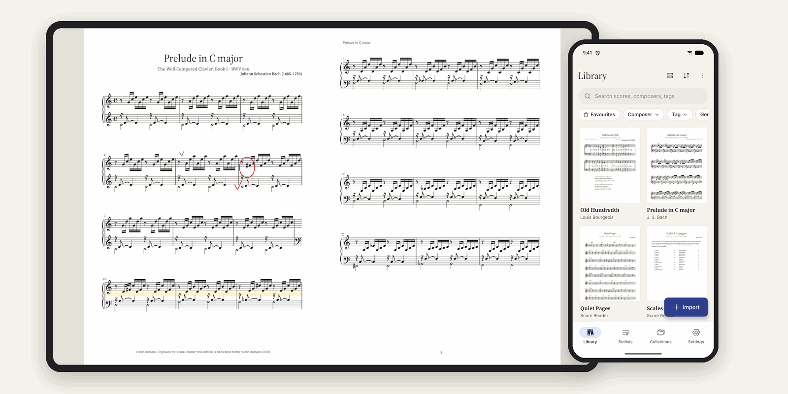

</div>

---

## 🎼 The moment that matters

It's the last chorus. The room is full, the drummer is leaning into the fill, and your right hand is on the keys while your left reaches for the bottom of the page.

You can't stop to turn it. So you tap the pedal under your foot.

**The next page is already there.** Not "loading". Not a half-drawn blur. Just there, about the time it takes a screen to draw one frame. You never look down.

That one moment is the reason this app exists. Everything else is built around it.

---

## 😣 The problem

Musicians have been swapping paper binders for tablets for over a decade. On the iPad they have **forScore**, a much-loved reader. On Android, where nearly half of all tablets live, **there is no forScore.** There's no OnSong, no Piascore and no Newzik app either.

The Android apps that do exist leave musicians with a familiar list of complaints (we read hundreds of store reviews and forum threads before writing a line of code):

| What musicians told us | How often it came up |
|---|---|
| "Sync lost my annotations / duplicated my library" | 🔴 most common |
| "It crashed / froze / jumped back to the library mid-song" | 🔴 very common |
| "Another subscription. Another login." | 🟠 common |
| "The interface feels like 2012 and takes weeks to learn" | 🟠 common |
| "My pedal stops working" · "Big PDFs lag or show blank pages" | 🟡 regular |

Almost nobody said *"it needs more features."* They said: **make it fast, make it calm, and don't lose my stuff.**

---

## 💡 Meet Score Reader

Score Reader is a PDF sheet-music reader for Android that keeps five promises:

| | Promise | What it means for you |
|---|---|---|
| ⚡ | **Instant** | A pedal press shows the next page in well under 50 ms. Animations never slow a page turn. |
| 🔒 | **Private** | No account, no analytics, no ads. The release app doesn't even have internet permission (apart from Google Play's purchase screen). |
| ✈️ | **Offline** | Everything works in a basement, on a plane, or in a church with no signal. |
| ↩️ | **Forgiving** | Every delete can be undone. Deleted scores wait 30 days in a Trash. Backups are one file you control. |
| 🤝 | **Honest** | Free for up to 15 scores. Then one fair price, once, for every Android device you own. No subscription, no nag pop-ups. |

> **The score is the hero.** Buttons appear when you ask for them and get out of the way when you don't.

The first time you open it, the app introduces itself in three calm steps, then gets out of the way:

<p align="center">
  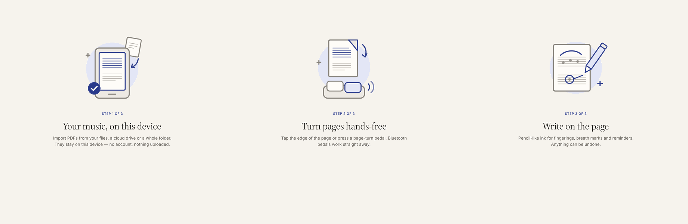
</p>

---

## 🗓️ A week with Score Reader

Here's what the app does, told the way you'd actually use it.

### Sunday: the binder goes digital

You point Score Reader at the folder of PDFs you've collected over the years. It copies them in the background while you keep browsing. Subfolders become **collections**. Messy filenames like `03_ode_to_joy_beethoven.pdf` become a clean title (*Ode to Joy*) and composer (*Beethoven*). Duplicates are skipped and broken files are named, never silently dropped.

<p align="center">
  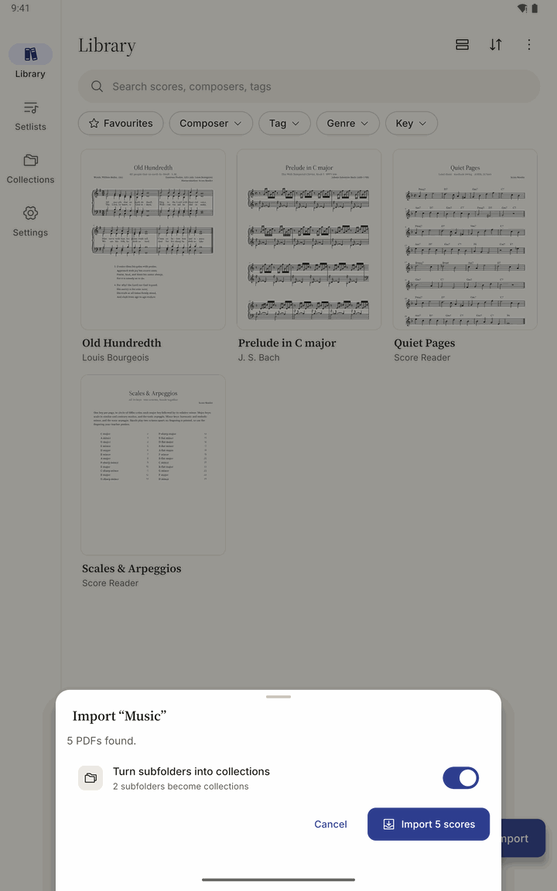
  &nbsp;
  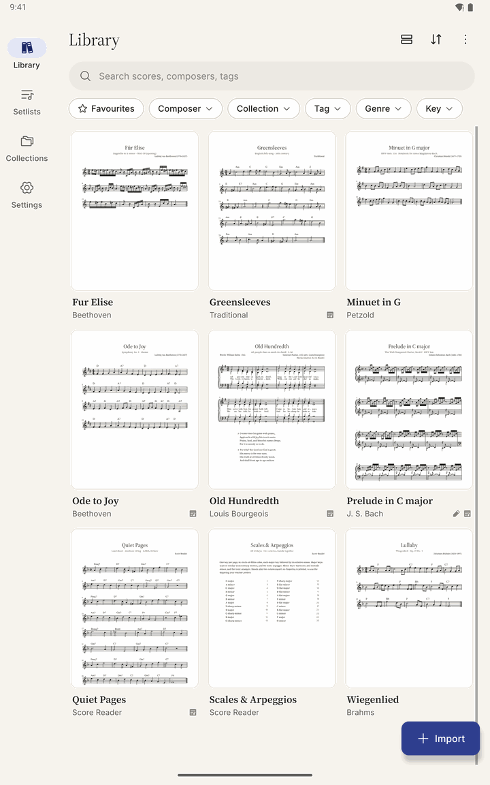
</p>
<p align="center"><sub><b>Left:</b> one tap imports a whole folder. <b>Right:</b> a minute later, a library. Covers are cropped to the first line of music, so you recognise a piece at a glance.</sub></p>

You can also share a PDF straight from Drive, email, WhatsApp or the browser.

### Monday: finding anything in a heartbeat

Start typing and results appear while you type, grouped by composer and score. It doesn't care about accents: **"Dvorak" finds "Dvořák"**. Five thousand scores feel the same as fifty.

<p align="center">
  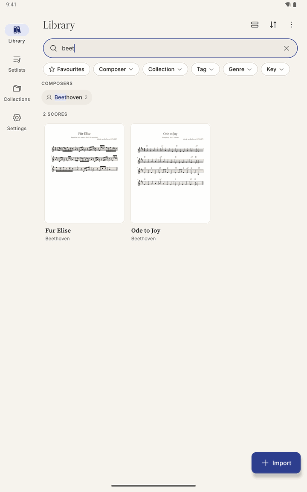
</p>

### Wednesday: rehearsal

The teacher circles a tricky F♯ and adds a breath mark. You pick up your stylus and write it in: a pencil, an ink pen, a red "teacher" pen and a yellow highlighter, with an eraser and undo. With a stylus you just write; with a finger you switch on annotate mode first, so you never mark the page by accident.

Practising a page turn that always catches you out? Switch on **half-page turns**: the top of the next page slides in while you're still reading the bottom of this one.

<p align="center">
  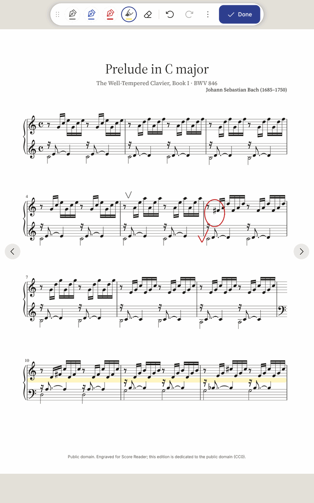
  &nbsp;
  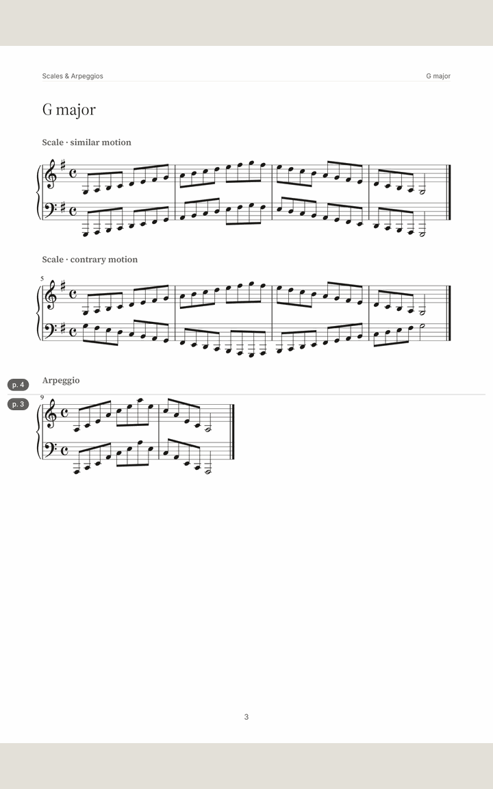
</p>
<p align="center"><sub><b>Left:</b> rehearsal marks in pencil, red pen and highlighter. <b>Right:</b> a half-page turn, with page 4 already on top while you finish page 3.</sub></p>

Turn the tablet sideways and you get **two pages side by side**, like an open book. Your markings come with you.

<p align="center">
  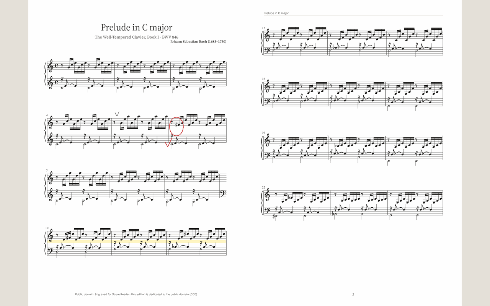
</p>

### Friday: the gig

You built tonight's **setlist** in a minute, with a note for the band. On stage, your Bluetooth foot pedal turns the pages. Press it on the last page of a song and the next song opens, and a small **"Next"** pill tells you what's coming before you get there.

<p align="center">
  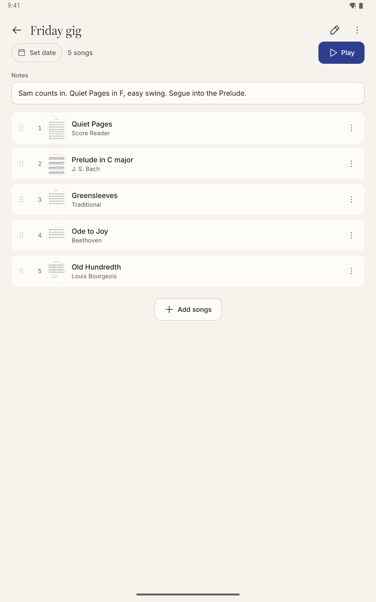
  &nbsp;
  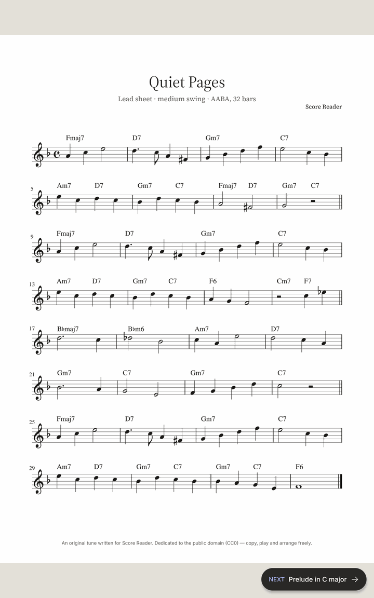
</p>

Switch on **performance mode** and every button disappears. The screen stays awake, stray touches can't change anything, and you leave by holding the middle of the page for one second. Dark stage? The *Night* filter turns the paper black and keeps your markings readable.

<p align="center">
  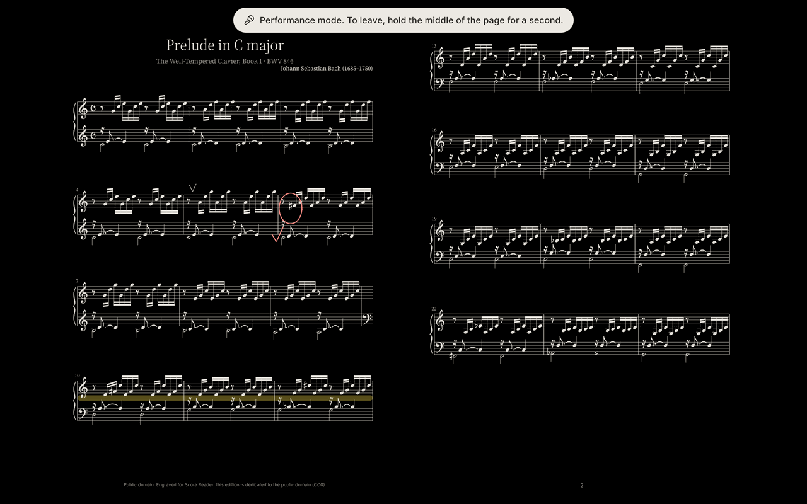
</p>

Not sure which buttons your pedal sends? Press it on the **Pedals** screen and the matching tile lights up. Any key can be reassigned.

<p align="center">
  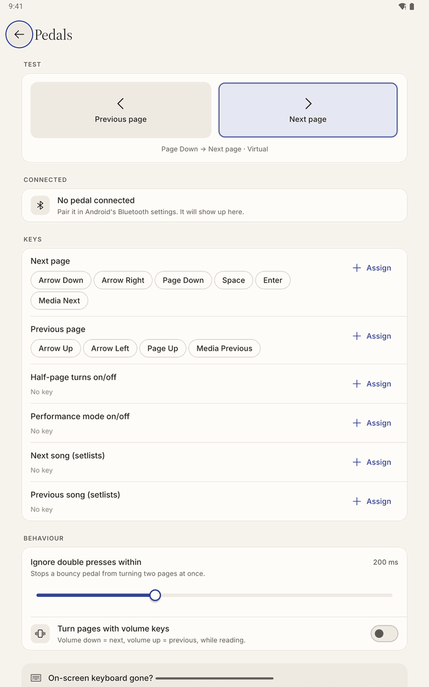
</p>

### Saturday: peace of mind

One tap saves everything (scores, markings, setlists, settings) into **a single backup file**, saved wherever you choose: your device, an SD card or a cloud folder. A new tablet? Restore it and everything is back.

And when your library outgrows the free 15 scores, the only screen that ever asks for money tells you plainly what you get:

<p align="center">
  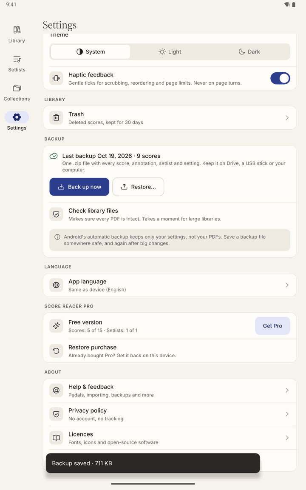
  &nbsp;
  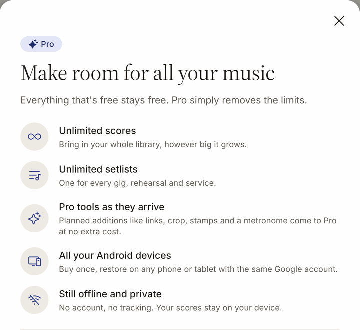
</p>

### Phones too

The app is designed tablet-first, but the same library and reader work on a phone, with a bottom navigation bar instead of the side rail.

<p align="center">
  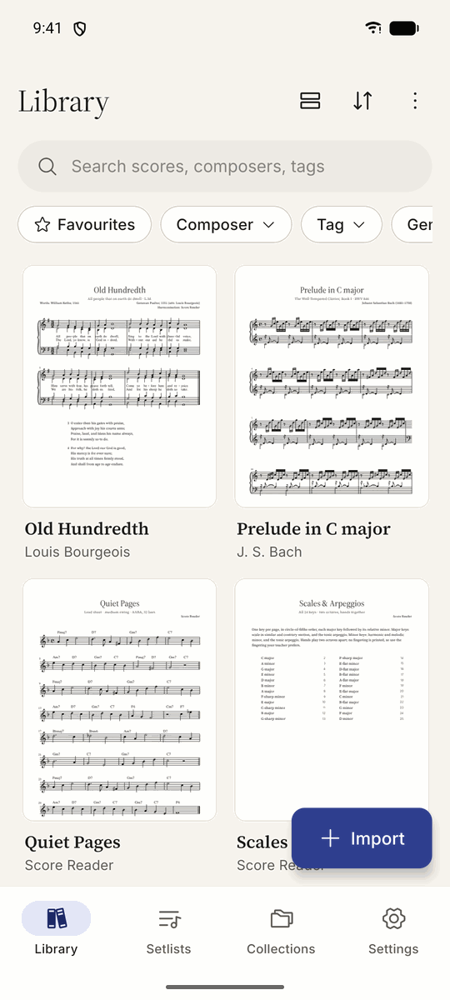
  &nbsp;
  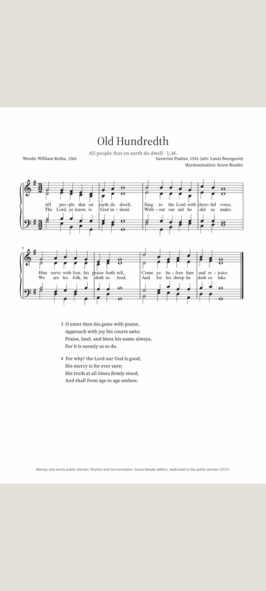
</p>

<details>
<summary><b>Also built in</b></summary>

- 🌍 Six languages at launch: English, German, Spanish, French, Italian, Japanese
- ♿ Full accessibility: TalkBack labels on every control, keyboard and D-pad focus, readable at 200% font size, respects "Remove animations"
- 📖 Reopens every score on the page where you left off
- 🎹 Four public-domain sample scores to try on first launch (they don't count toward the free limit)
- 🧾 If the app ever crashes, it offers to show you the report and lets *you* decide whether to send it
- 👆 A one-time hint shows where to tap to turn pages:

  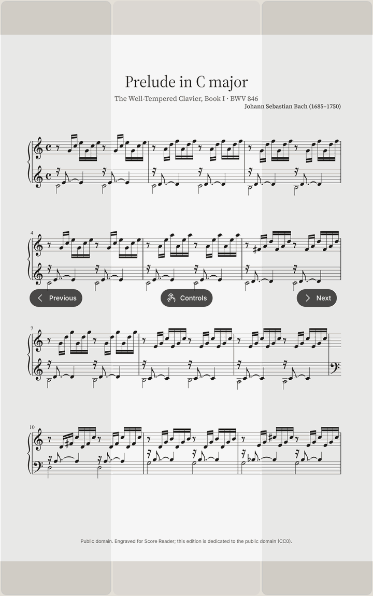

</details>

<details>
<summary><b>New to some of these words?</b> A tiny glossary</summary>

| Word | Plain meaning |
|---|---|
| **Score** | A piece of sheet music, here as a PDF file |
| **Page-turn pedal** | A small Bluetooth foot switch. Musicians use it to turn pages without taking their hands off the instrument |
| **Setlist** | The ordered list of songs for a concert or service |
| **Annotation** | Your own pencil markings on the music: fingerings, breath marks, reminders |
| **Half-page turn** | Turning half a page at a time, so the next lines are visible before you finish the current ones |
| **Offline** | Works with no internet connection at all |

</details>

<sub>Screenshots: a release build on an 11" Android tablet emulator and a phone emulator. Scores shown are public-domain works or originals, engraved for the project.</sub>


---

## 📊 Proof, not promises

"Fast" is easy to claim, so we measure it. Every build phase ends with a benchmark report in [`docs/benchmarks/`](docs/benchmarks/).

| What we tested | Target | Result | In plain words |
|---|---|---|---|
| Pedal press → new page on screen (95th percentile, release build) | < 50 ms | **20 ms** | About one screen refresh. Faster than you can notice |
| Open a 300-page, 100 MB scanned book | < 1 s | **86 ms** | Opens before your finger leaves the screen |
| 500 pedal presses through a 300-page score | no misses | **500 turns, 0 doubles, 0 misses** | It never skips or repeats a page |
| Search across 5,213 scores (95th percentile) | < 50 ms | **14 ms** | Results while you're still typing |
| Import 200 PDFs (~1 GB) from a folder | no freezes | **< 32 s, zero freezes** | Grab a coffee? Not needed |
| Open and close a score 100 times while pages are rendering | no crash | **0 crashes, 0 leaks** | Tough under rough handling |

<sub>Measured on an Android tablet emulator (11", 16:10). Emulator numbers tend to be optimistic, so every test is re-run on real tablets, phones and pedals before launch.</sub>

---

## 🧭 Where it stands

The app is being built in eight phases. Seven are done.

```
✅ 1  Foundation & design system      ✅ 5  Annotation (pen, highlighter, eraser, undo)
✅ 2  Native rendering engine          ✅ 6  Setlists, collections & backup
✅ 3  Reader & pedals                  ✅ 7  Purchases, onboarding, 6 languages, accessibility
✅ 4  Import & library                 ⏳ 8  Real-hardware testing, polish & Play Store launch
```

**Next, after launch:** jump links for repeats and D.S./coda, margin cropping, music stamps, annotation layers, lasso select, page manager, metronome, tuner and pitch pipe, and camera scanning. See [the roadmap](docs/PLAN.md#7-after-launch-p1-roadmap-in-order).

> The app isn't on the Play Store yet. If you build it yourself today, you're seeing a pre-release.

---

## 🛠️ Under the hood

*This part is for developers.*

### The idea in one sentence
React Native owns the screens and the data. **Kotlin owns everything that has to be instant**: PDF rendering, pedal keys and ink.

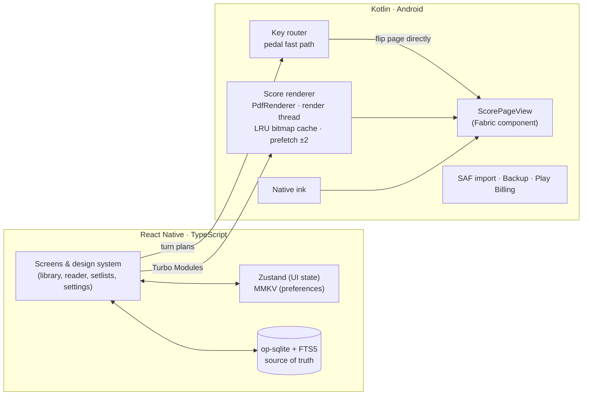

**The pedal fast path:** JavaScript tells native code in advance what the next pedal press should do. When the key arrives, Kotlin flips the page on its own, without waiting for a round trip through JavaScript. That's how a turn lands in roughly one frame.

### Stack

| Layer | Choice |
|---|---|
| App | **Bare React Native 0.87** (no Expo) · New Architecture · Hermes · TypeScript strict |
| Native | Kotlin Turbo Modules + a Fabric view, codegen specs in [`src/specs/`](src/specs/) |
| Rendering | Custom module on `android.graphics.pdf.PdfRenderer`, GPU colour-matrix page filters |
| Data | op-sqlite (FTS5, accent-insensitive search) · Zustand · MMKV |
| UI | React Navigation 7 · FlashList v2 · Reanimated 4 · Gesture Handler · Phosphor icons · Source Serif 4 + Inter |
| i18n | i18next, ICU plurals, per-app language on Android 13+ |
| Billing | Own Kotlin module on Play Billing 8 |
| Quality | Jest + Testing Library, Kotlin instrumentation benchmarks, contrast tests for every colour token, CI with a 16 KB page-size alignment check |

### Run it

You need **Node 22+**, **JDK 17**, and the **Android SDK + NDK**. Full details are in [`docs/DEV_SETUP.md`](docs/DEV_SETUP.md).

```bash
npm ci
```

```bash
npm start
```

```bash
npm run android
```

Before you push, run the same checks CI runs (typecheck, lint, tests):

```bash
npm run verify
```

### Project map

```
android/            Kotlin: renderer, ScorePageView, key router, ink, import, backup, billing
src/
  app/              navigation
  features/         one folder per feature: reader, library, import, ink, setlists, backup, …
  domain/           pure logic (search queries, title parsing, pedal mapping, turn plans)
  data/             SQLite schema, migrations, repositories, preferences
  ui/               design system: theme tokens, components, icons
  i18n/locales/     en, de, es, fr, it, ja
  specs/            Turbo Module / Fabric codegen specs
design/             app icon, custom icons, sample-score sources
docs/               product spec, build plan, privacy policy, backup format, benchmarks
scripts/            icon, sample-score and licence generators; test-PDF corpus
```

### Docs worth reading

| Doc | What's inside |
|---|---|
| [`PRODUCT_SPEC.md`](docs/PRODUCT_SPEC.md) | Market research, competitor review analysis, personas, full feature spec |
| [`PLAN.md`](docs/PLAN.md) | Guiding principles, locked decisions, design system, the 8 phases, risks |
| [`benchmarks/`](docs/benchmarks/) | How performance is measured, plus a results report per phase |
| [`BACKUP_FORMAT.md`](docs/BACKUP_FORMAT.md) | The backup file format, so your data is never locked in |
| [`PRIVACY.md`](docs/PRIVACY.md) | The privacy policy, in plain language |

---

## 🤲 Contributing

Ideas, bug reports and pull requests are welcome. A few house rules keep the app feeling the way it does:

- **Speed is a feature.** Nothing may delay a page turn.
- **Nothing is lost by accident.** Destructive actions need an undo or a Trash.
- **No network, no tracking.** New dependencies must not phone home.
- **Every screen, every state.** Empty, loading, error, long German text, 200% font and TalkBack are all part of "done".

Please run `npm run verify` before opening a PR and use [conventional commits](https://www.conventionalcommits.org/).

---

## 🙏 Standing on the shoulders of

[Phosphor Icons](https://phosphoricons.com) · [Bravura / SMuFL](https://www.smufl.org) · [Verovio](https://www.verovio.org) (engraves the sample scores at build time) · [Source Serif 4](https://github.com/adobe-fonts/source-serif) · [Inter](https://rsms.me/inter/) · [op-sqlite](https://github.com/OP-Engineering/op-sqlite) · [FlashList](https://shopify.github.io/flash-list/) · and the React Native community.

Sample scores are public-domain works or original material, engraved here and released as CC0. See [`design/samples/SOURCES.md`](design/samples/SOURCES.md).

## 📄 License

_License to be added._

<div align="center">
<br/>
<sub>Built for every musician who has ever lost their place at a page turn.</sub>
</div>
